# Netflix Customer Intelligence, Churn Prediction & AI Analytics Copilot

An end-to-end analytics project on a synthetic Netflix-style subscription business: a cleaned **MySQL** database, **37 SQL business questions**, a 32-chart EDA, **three ML models** (churn, segmentation, lifetime value), a **free-LLM AI copilot** with six capabilities, and a 7-page **Streamlit dashboard**.

> **The honest headline:** churn in this dataset is deliberately noisy. The leakage-safe churn model reaches **ROC-AUC 0.62** (a leaky build would show 0.71 and be useless in production). The project is built around that fact: calibrated probabilities, cost-aware retention decisions, and statistical tests instead of invented explanations.

---

## Screenshots

### Executive overview
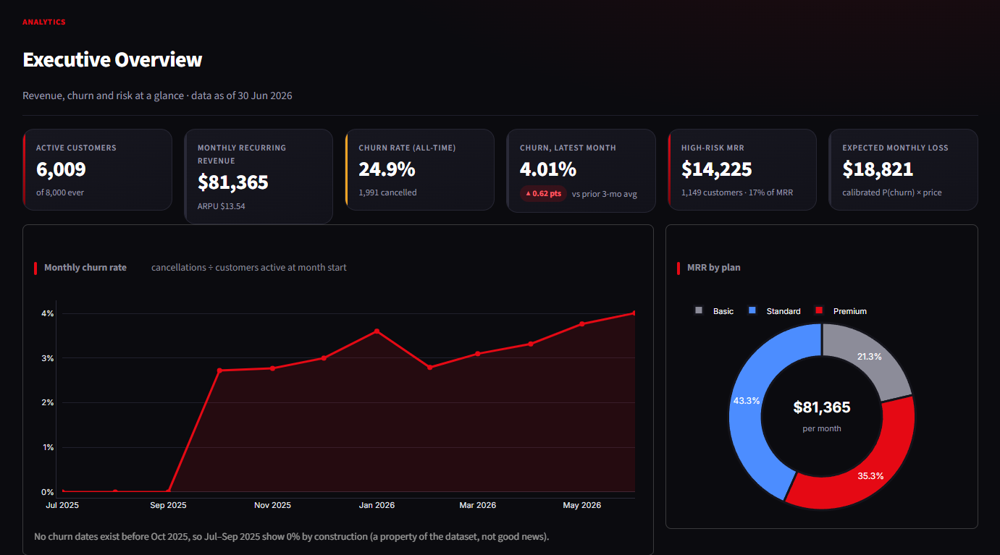 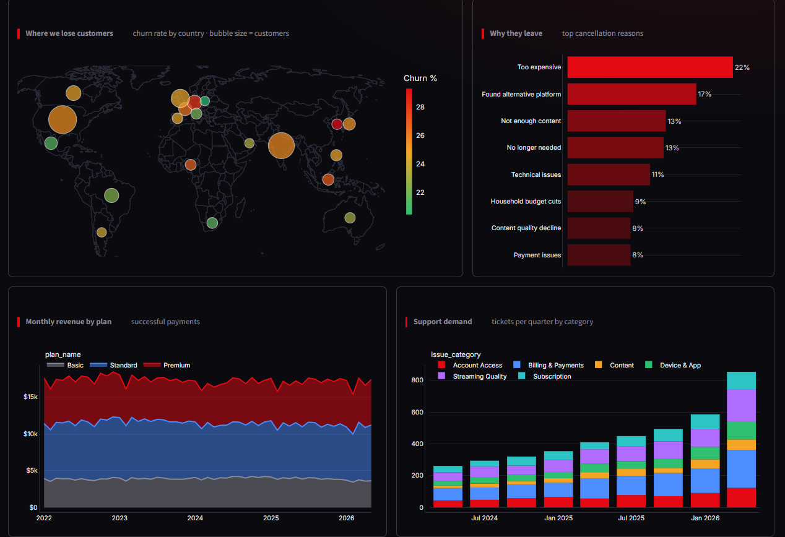

*KPIs, monthly churn trend, MRR by plan, churn by country on a world map, cancellation reasons, revenue and support demand.*

### Customer analytics and churn risk
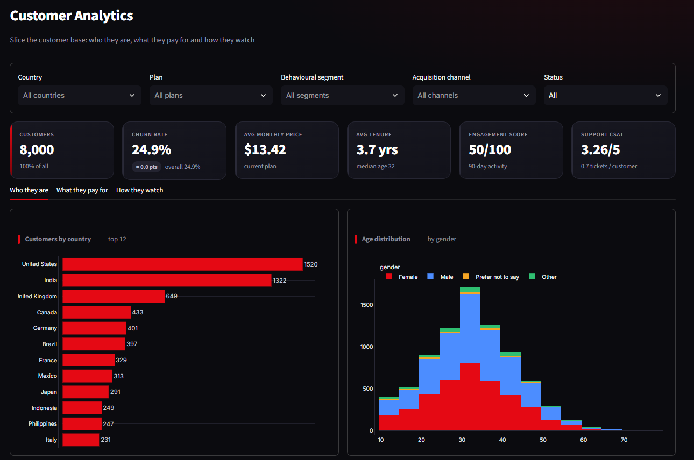 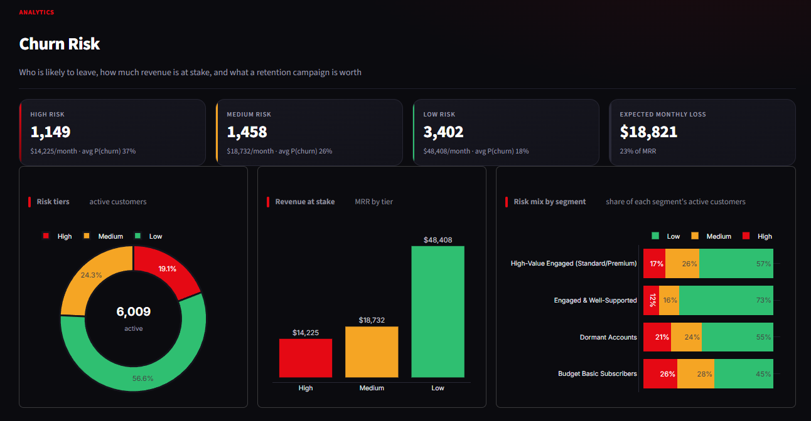

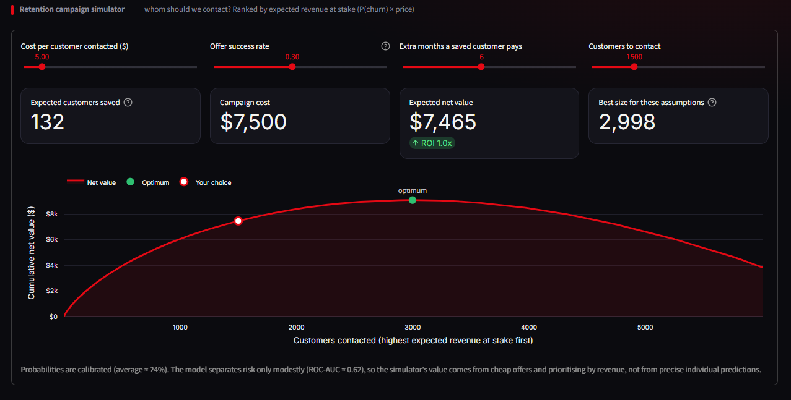

*Filterable analytics, risk tiers with revenue at stake, and an interactive retention-campaign simulator that finds the most profitable number of customers to contact.*

### Segmentation
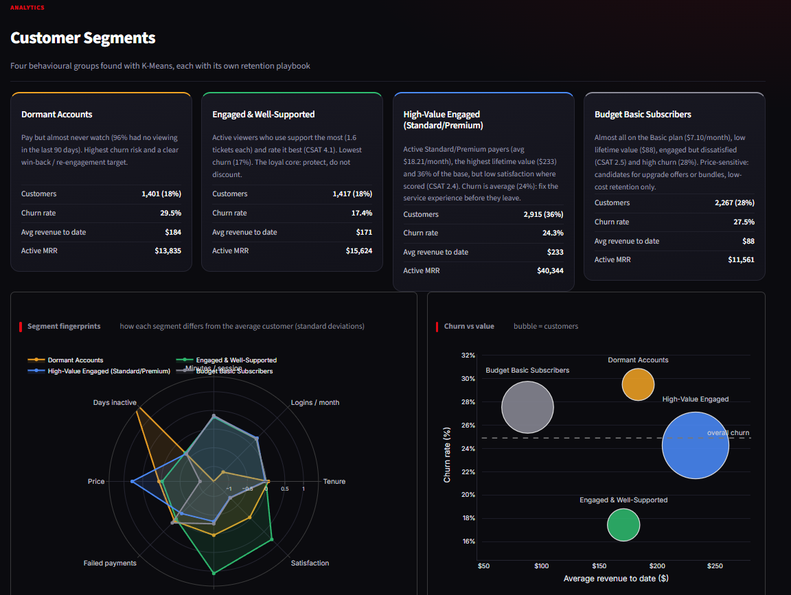 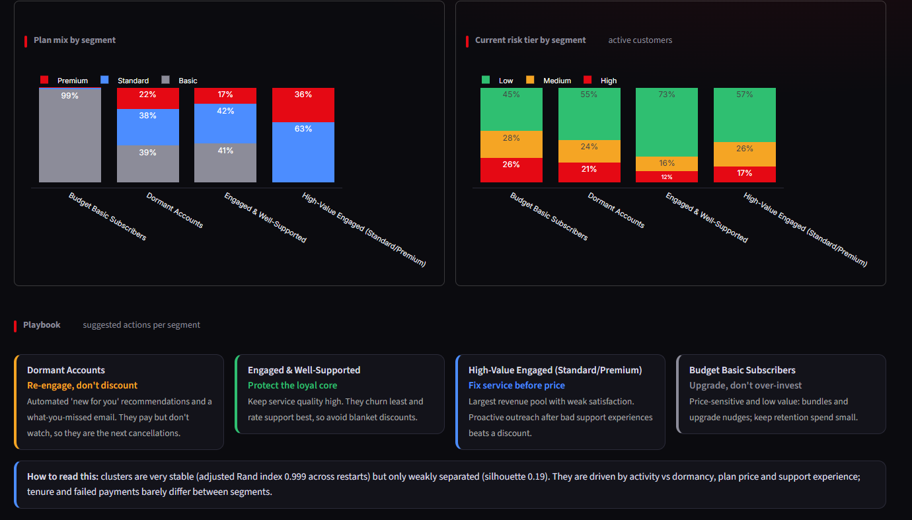

*Four behavioural segments with fingerprints, churn-vs-value view and a retention playbook for each.*

### Customer 360
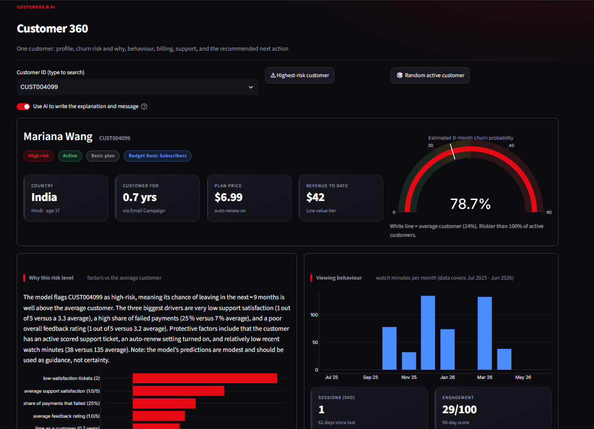 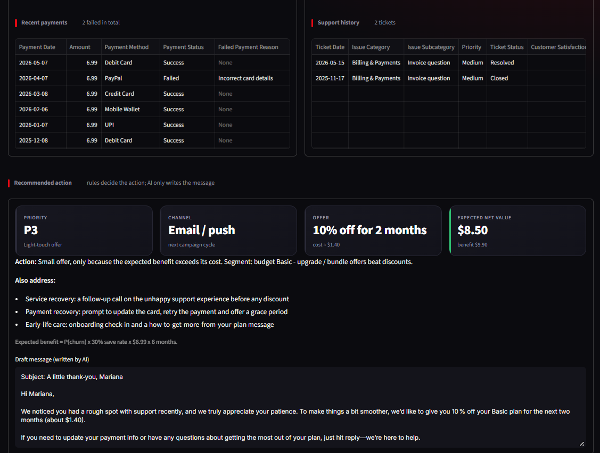

*One customer: risk gauge, factors raising or lowering risk, viewing, billing and support history, and a cost-checked recommended action with a draft message.*

### AI Copilot
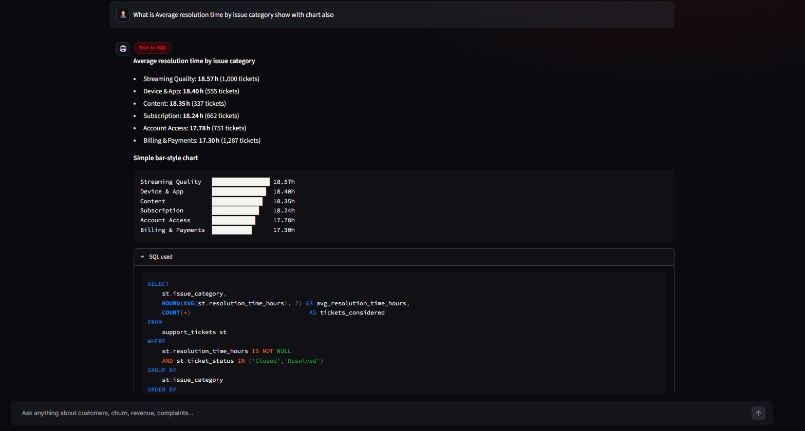 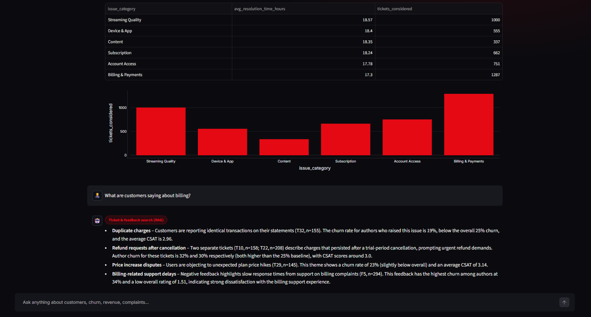

*Plain-English questions to validated SQL with the query shown, ticket-and-feedback themes, and risk explanations.*

### Reports and model cards
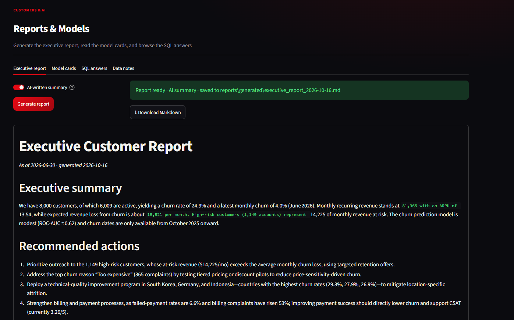 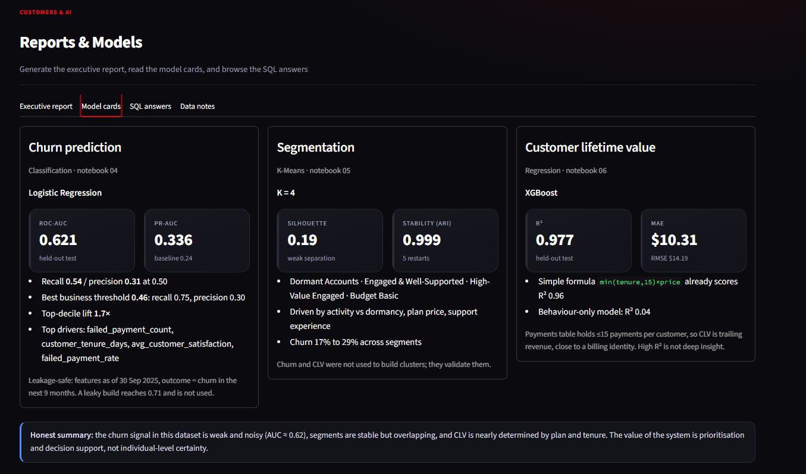

---

## Results at a glance

| Area | Result |
|---|---|
| **Data** | 8,000 customers, 66k viewing sessions, 110k payments, 6k tickets, 5k feedback entries; 24.9% churned |
| **Cleaning** | 11 documented fixes (duplicates, 83 country spellings, device labels, impossible ages, outliers, anomalous payment amounts, 5% mislabeled sentiment, blank payment links), all logged |
| **SQL** | 37 questions (intermediate, window functions, multi-CTE), tested in MySQL strict mode and cross-checked against pandas |
| **Churn model** | Logistic Regression, test ROC-AUC **0.62**, recall 0.54 / precision 0.31 at 0.50; top risk decile churns at **1.7x** the average; calibrated probabilities |
| **Retention economics** | With a $5 offer, 30% success and $81 value per saved customer, targeting by model beats contacting everyone by about 54% |
| **Segmentation** | K-Means, K=4, very stable (ARI 0.999) but weakly separated (silhouette 0.19); churn ranges 17% to 29% across segments |
| **Lifetime value** | XGBoost R² 0.977, MAE $10.32; a one-line formula already scores R² 0.96, so the high score is not deep insight (see limitations) |
| **Copilot** | 6 capabilities, 62 automated tests, SQL safety layer, works on free LLM tiers |

### What drives churn
| Signal | Lowest churn | Highest churn |
|---|---|---|
| Tenure | 18.8% (5+ years) | 42.2% (under 6 months) |
| Failed payments | 20.3% (none) | 40.8% (3 or more) |
| Support tickets | 22.3% (1 ticket) | 39.2% (4 or more) |
| Engagement | 13.4% (very high) | 29.6% (no activity) |

Country, acquisition channel and plan are weak predictors. Billing & Payments is the largest complaint category and has the lowest satisfaction (2.98 / 5).

---

## The AI Copilot

Six capabilities, routed by a rule-based router (no LLM call spent on routing):

| # | Capability | How it stays trustworthy |
|---|---|---|
| 1 | **Text-to-SQL** | Validator allows one SELECT only, blocks write/DDL, comments, system schemas and `SLEEP()`-style functions; runs read-only with a time limit; rewrites the query when MySQL errors |
| 2 | **RAG over tickets and feedback** | TF-IDF over the 32 distinct ticket texts and 13 feedback texts, with volumes, churn and CSAT computed from raw rows and filters (country, plan, time) |
| 3 | **Churn explainer** | Contributions come from the model coefficients, compared with the average customer; states the model is modest |
| 4 | **Report generator** | Every number is computed in code; the LLM writes only the summary and actions |
| 5 | **Root-cause analysis** | A deterministic investigator runs statistical tests; the LLM only narrates. It says "not significant" when that is the truth |
| 6 | **Retention recommender** | Rules choose the action; an offer is recommended only if its expected benefit exceeds its cost; the LLM only writes the message |

Runs on **free** providers through one OpenAI-compatible client: **Groq** (default, `openai/gpt-oss-120b`), Gemini, Mistral or local Ollama. The client retries on rate limits, falls back to a smaller model, and auto-discovers a working model if one is retired (Groq retired `llama-3.3-70b-versatile` in Aug 2026). Without an API key every capability except text-to-SQL still works with template text.

---

## Key design decisions

- **No leakage.** Features are computed *as of* a date. The churn model trains on a 2025-09-30 snapshot and predicts churn in the following 9 months, then scores today's customers. Notebook 03 shows the cost of getting this wrong (AUC 0.71 leaky vs 0.60 honest).
- **Calibrated probabilities.** Class weighting makes raw scores average about 0.5 against a 24% base rate. Platt scaling turns them into usable probabilities, and money figures use those.
- **LLMs never invent numbers.** Statistics, tables and SQL results come from code; the LLM narrates.
- **Defence in depth for SQL.** Validator, read-only transaction with a time limit, and a recommended read-only database user.
- **Reference date = 2026-06-30**, the latest date in the data, so "last 12 months" is always meaningful.

---

## Limitations (stated openly)

- **Churn signal is weak** (AUC 0.62). Scores prioritise customers; they do not predict individuals reliably.
- **Churn dates start 3 Oct 2025**, so earlier months show no churn and old cohorts look 100% retained by construction.
- **The payments table keeps at most 15 payments per customer**, so "lifetime value" is trailing revenue, close to a billing identity. High R² there is not deep predictive power, and behaviour-only features reach just R² 0.04.
- `subscriptions.monthly_price` never changes within a customer, so a plan switch is the only "price change" signal; 305 of 875 plan changes are same-plan.
- Viewing history covers only Jul 2025 - Jun 2026.
- Segments are stable but overlapping (silhouette 0.19).

---

## Project structure

```
customer-intelligence-platform/
├── app/                      Streamlit dashboard (dashboard.py, ui.py, data.py, pages/1..7)
├── data/
│   ├── raw/                  the 9 source CSVs
│   └── processed/            cleaned tables, features, scores, segments, data_quality_log.csv
├── database/                 schema.sql (MySQL), load_data.py, sql_business_questions.sql, run_queries.py
├── docs/screenshots/         README images
├── models/                   churn, segmentation and CLV models (joblib)
├── notebooks/                01 cleaning · 02 EDA · 03 features · 04 churn · 05 segmentation · 06 CLV
├── reports/                  figures/, sql_results/, model metrics (json)
├── src/
│   ├── features/             build_features.py (leakage-safe, as-of-date features)
│   ├── llm/                  the six copilot capabilities, router, SQL validator, LLM client
│   ├── database/ · utils/    MySQL access, config, data loader (with calibration)
├── tests/                    SQL-safety, copilot and LLM-client tests
├── .streamlit/config.toml    dark theme
└── requirements.txt
```

---

## Setup and run

```bash
python -m venv venv
venv\Scripts\activate                 # Mac/Linux: source venv/bin/activate
pip install -r requirements.txt
.env                
```
Edit `.env`: set `DB_PASSWORD` and `GROQ_API_KEY` (free key at console.groq.com).

| Step | Command / file | Output |
|---|---|---|
| 1 | `notebooks/01_data_cleaning.ipynb` | cleaned CSVs + data-quality log |
| 2 | `mysql -u root -p < database/schema.sql` | database `netflix_ci`, 9 tables |
| 3 | `python database/load_data.py` | data loaded through SQLAlchemy |
| 4 | `database/sql_business_questions.sql` in MySQL Workbench | 37 answers |
| 5 | `python database/run_queries.py` | saves every result to `reports/sql_results/` |
| 6 | notebooks `02` to `06`, in order | EDA, features, three models, scores |
| 7 | `python -m src.llm.health_check` | checks `.env`, MySQL, validator, LLM key, one live question |
| 8 | `pytest tests -q` | 62 tests |
| 9 | `streamlit run app/dashboard.py` (from the project root) | the dashboard |

The dashboard reads the processed CSVs, so every page except text-to-SQL works without MySQL.

---

## Tech stack

Python · pandas · scikit-learn · XGBoost · SciPy · MySQL 8 · SQLAlchemy · Streamlit · Plotly · Groq / OpenAI-compatible API · pytest

---

## Author

**[Samar Markande]** 
